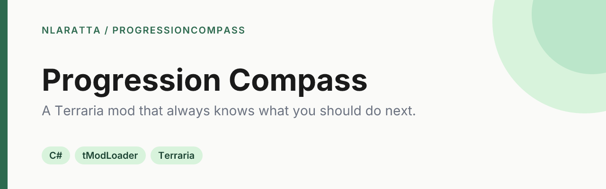

<p align="center">
  
</p>

<p align="center">
  <a href="https://github.com/nlaratta/ProgressionCompass/actions/workflows/ci.yml"></a>
  <a href="LICENSE"></a>
</p>

A client-side [tModLoader](https://github.com/tModLoader/tModLoader) mod for Terraria that tells you what to do next. It scans everything you own, works out which upgrades are within reach and what you're missing, and tells you where to get it.

## What it does

- **Knows what you own.** It scans your inventory, equipment, piggy bank and other banks, nearby chests, and Magic Storage.
- **Shows what's next.** Gear upgrades are ranked by your class (melee, ranged, mage or summoner), your progression tier, and what you have equipped. The dashboard sorts them into Ready to craft, Almost ready, and Building toward.
- **Tells you where.** The step-by-step craft order includes sources, drop rates and alternatives. An action plan groups everything you need to farm, buy, craft or trigger by location, so you make one trip instead of ten.
- **Tracks your goals.** Pin any item to get a HUD overlay showing your progress toward it.
- **Plans bosses.** It shows the boss order with summon hints, and integrates with Boss Checklist when it's installed.

It covers shimmer transforms, shop prices and conditions, and expert/master-only drops. It also works with every loaded content mod (Calamity, Thorium and others) because it reads the game's live recipe and drop data. It's client-side only, so it has no effect on a multiplayer server.

| Key | Action |
|---|---|
| <kbd>P</kbd> | Open or close Progression Compass |
| <kbd>I</kbd> | Inspect the item under your cursor |

Both keys can be rebound in Settings → Controls. Options for chest scan range, the default tab and tree expansion are under Mod Configuration.

## Quick start

You need Terraria with [tModLoader](https://store.steampowered.com/app/1281930/tModLoader/) (free on Steam) and the [.NET 8 SDK](https://dotnet.microsoft.com/download/dotnet/8.0).

```bash
git clone https://github.com/nlaratta/ProgressionCompass.git
cd ProgressionCompass
dotnet build
```

The build finds tModLoader in the default Steam location and installs `ProgressionCompass.tmod` into your tModLoader Mods folder. Launch tModLoader, enable **Progression Compass** under Workshop → Manage Mods, and press <kbd>P</kbd> in a world.

If tModLoader is installed somewhere else, point the build at it with one of these:

```bash
dotnet build -p:tMLInstallDir="/path/to/tModLoader"   # one-off
export TML_INSTALL_DIR="/path/to/tModLoader"          # per shell
cp Directory.Build.props.example Directory.Build.props  # per checkout, then edit the path
```

## How it works

1. **Indexing.** After recipes load, the mod indexes every recipe, NPC drop and shop into lookup tables, so later queries don't walk the game's raw arrays.
2. **Scanning.** Opening the UI takes a snapshot of everything you own.
3. **Resolving.** A depth-first resolver builds the cheapest crafting tree for a target. It uses snapshot-and-rollback when it backtracks, so a losing branch never consumes materials a later branch needs, and it detects cycles per path.
4. **Ranking.** Candidate upgrades are scored by class, tier and current loadout to produce the dashboard and action plan.

## Project structure

```
ProgressionCompassMod.cs   entry point and keybinds
Common/                    systems (recipe, source and station indexes; UI lifecycle), players, config
Content/Graph/             inventory scanning and the dependency resolver
Content/Progression/       tiers, class detection, boss data, gear scoring
Content/Tracking/          pinned goals and the location-grouped action plan
UI/                        panels and reusable UI elements
Localization/en-US.hjson   every user-facing string
docs/notes/                design notes, research and the issue list
```

## Status

Version 0.1.0. It hasn't been published to the Steam Workshop yet. [docs/notes/ISSUES.md](docs/notes/ISSUES.md) tracks what's left before release.

## License

[MIT](LICENSE) © Noah Laratta. Terraria and tModLoader belong to their respective owners. This is an unofficial mod.
